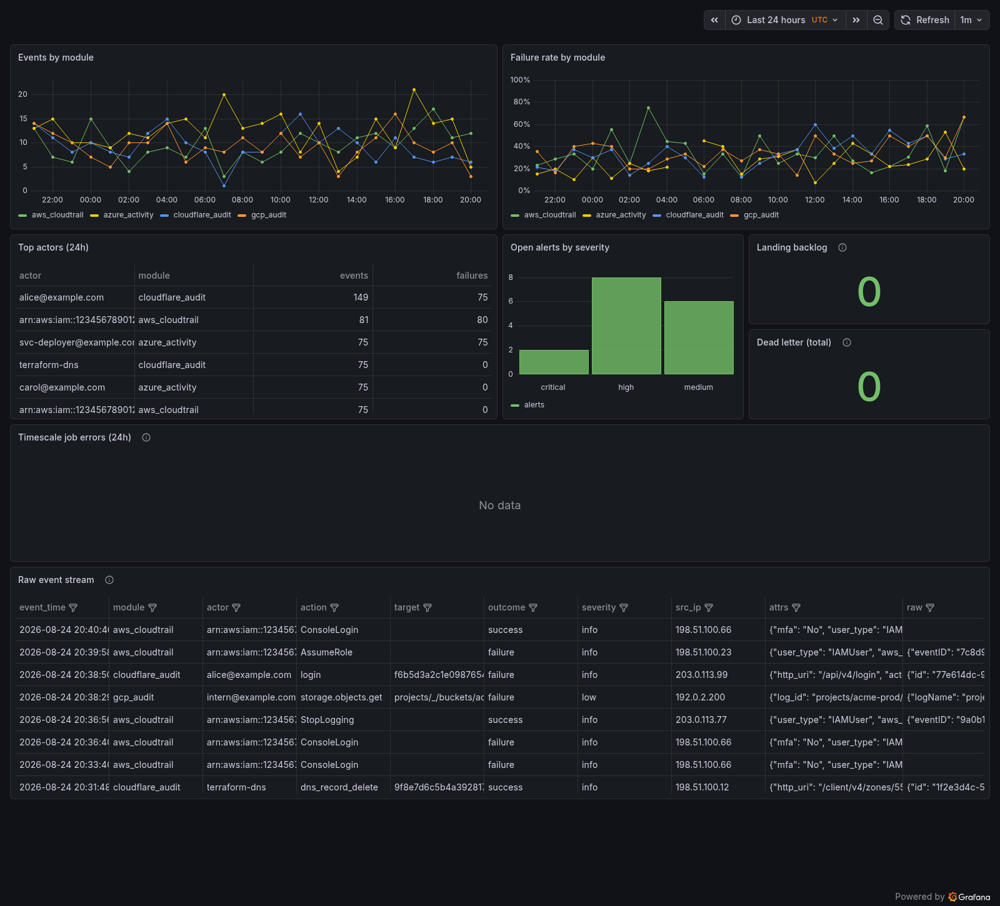

# caib — Cloud Audit In a Box

A self-hostable cloud/SaaS audit-log SIEM on boring infrastructure:
**Vector + PostgreSQL/TimescaleDB + Grafana**, packaged with Docker Compose.
Each log source is a module that ships everything end-to-end: collector config,
field mapping, migrations, a provisioned dashboard, seed detection rules, a
dead-man rule, and test fixtures.

Full design: [`caib-build-spec.md`](caib-build-spec.md). Deviations and
empirical findings: [`DECISIONS.md`](DECISIONS.md).

## Quickstart (dev)

Requires Docker with the Compose plugin.

```sh
make up        # generates .env with random passwords on first run, builds, starts
make demo      # seed fixture data (30 days) + fire sample detections — no cloud creds
# Grafana: http://127.0.0.1:3000 (admin / CAIB_GRAFANA_ADMIN_PASSWORD, printed
# by the first `make up` and stored in .env)
make logs      # follow everything
make down      # stop
```

Postgres and Grafana bind to `127.0.0.1` (`CAIB_BIND_ADDR`). Putting this on a
real host — reverse proxy, TLS, what to monitor — is
[docs/DEPLOY.md](docs/DEPLOY.md).

`make demo` gets a cold clone to populated dashboards (Overview, per-module,
Alerts) and real firing alerts in under two minutes.

## What it looks like

Everything below is `make demo` output — synthetic fixture data, zero cloud
credentials, zero clicks.

**Overview** — cross-module event rates, failure rates, open alerts, ingest
health, and the raw event stream:



**Alerts** — the detection engine's output, filterable by status/severity;
recurrences fold into one row with an event count:


**Per-module dashboards** (one per source; aws_cloudtrail shown) — module
event rates, top actors/actions, failures, module-specific panels, raw stream:


**Search** — the "find `foo-prod` in everything" workflow: substring match
over every event's curated fields (actor, action, target, src_ip, attrs),
trgm-indexed on the hot window:


Screenshots regenerate via the optional renderer overlay — see
[`compose.render.yml`](compose.render.yml).

Development also wants [`uv`](https://docs.astral.sh/uv/):

```sh
make test      # ruff + pytest (pytest starts a throwaway timescaledb container)
```

## Stack

| Component | Image | Notes |
|---|---|---|
| Database | `timescale/timescaledb:2.29.2-pg18` | TSL build required (Apache-only build lacks compression/retention/caggs) |
| Collector | `timberio/vector:0.57.0-debian` | push sources (S3/SQS, Pub/Sub) |
| Dashboards | `grafana/grafana:12.4.9` | fully provisioned, read-only DB role |
| Core services | `caib-core` (built here) | `migrate` / `loader` / `detect` entrypoints |
| Pollers | `caib-poller` (built here) | one image, `CAIB_MODULE` selects the module |
| Agent query layer | `caib-agent-api` (built here) | optional; read-only HTTP/JSON + MCP, profile `agent-api` |

## Agent query layer (optional)

A read-only query surface for LLM agents — an HTTP/JSON API and an MCP stdio
server over one shared query core.

```sh
docker compose --profile agent-api up -d
curl -sH "Authorization: Bearer $CAIB_AGENT_API_TOKEN" \
  'http://127.0.0.1:8088/v1/alerts/summary' | jq
```

Seven questions: `search_events`, `get_alerts`, `alert_summary`, `top_actors`,
`actor_activity`, `module_health`, `list_rules`. It connects as `caib_agent_ro`,
a role with `SELECT` on five tables and no write privilege at all — so it cannot
see the raw `ingest.*` payloads, and there is no way to acknowledge or close an
alert through it. Loopback-bound, bearer token required, and it refuses to start
without one.

Full reference, the grant rationale and how to point an MCP client at it:
**[docs/AGENT_API.md](docs/AGENT_API.md)**.

## How this compares

CAIB is deliberately narrow: **cloud and SaaS audit logs**, on infrastructure you
already run, with no per-GB bill. That scope is the whole design, and it is the
reason to pick it — or to pick something else.

| | CAIB | Security data lake (e.g. [Matano](https://github.com/matanolabs/matano)) | Commercial SIEM (e.g. Panther, Splunk, Sentinel) |
|---|---|---|---|
| Runs on | any Docker host — laptop, VPS, on-prem | an AWS account (deploys into it, serverless) | vendor cloud |
| Storage | one PostgreSQL + TimescaleDB | Iceberg on S3, queried via Athena/Trino/Snowflake | vendor-managed |
| Scale | single node — 1.3B events/day of measured ingest headroom, 90-day hot window | petabyte | petabyte |
| Cost model | your hardware | object storage + per-query scan | per-GB/TB ingested |
| Substring search | trgm-indexed, ~0.14 s over 30 days | per-query lake scan | vendor-indexed |
| Sources | 4 shipped, cloud/SaaS audit only | 50+, all security telemetry | many, all security telemetry |
| Operational surface | one compose file, one database | a serverless AWS stack | SaaS |

**Use a security lake or a commercial SIEM instead when** you need petabyte
scale, sources beyond cloud/SaaS audit logs (EDR, VPC flow, endpoint), query
from multiple engines over an open table format, or a vendor to call at 3am.
Those are real requirements and CAIB does not meet them.

**Use CAIB when** the audit logs *are* the point — who changed what in AWS, GCP,
Azure, Cloudflare, Slack — and you want them in a database you already know how
to operate, back up and query, with analyst search that answers in
milliseconds and a bill that does not scale with ingest.

The volume argument is the load-bearing one. Cloud and SaaS *audit* logs are
orders of magnitude smaller than host or network telemetry: a workload that fits
comfortably in one Postgres does not need a lake, and paying a lake's
operational and query cost to hold it is a bad trade. The numbers behind that
claim are in [Measured performance](#measured-performance-make-bench); the
ceiling it implies is in [Retention defaults](#retention-defaults).

## Modules

Enable a module by starting compose with its profile, e.g.
`docker compose --profile cloudflare_audit up -d`.

| Module | Type | Status |
|---|---|---|
| `aws_cloudtrail` | push (S3 → SQS → Vector) | ready: ingest + 7 rules + dashboard |
| `gcp_audit` | push (Pub/Sub → Vector) | ready: ingest + 5 rules + dashboard; live Pub/Sub verification pending |
| `azure_activity` | poller (ARM REST) | ready: ingest + 5 rules + dashboard; live verification pending |
| `cloudflare_audit` | poller | ready: ingest + 5 rules + dashboard; live API verification pending a token |
| `slack_audit` | poller | recipe in [docs/NEW_MODULE_HOWTO.md](docs/NEW_MODULE_HOWTO.md) |
| `zoom` | poller | recipe in [docs/NEW_MODULE_HOWTO.md](docs/NEW_MODULE_HOWTO.md) |
| `knowbe4` | poller | recipe in [docs/NEW_MODULE_HOWTO.md](docs/NEW_MODULE_HOWTO.md) |

Adding a source? Read [docs/NEW_MODULE_HOWTO.md](docs/NEW_MODULE_HOWTO.md).
Converting public Sigma cloud rules: `uv run python -m caib_core.sigma
--module aws_cloudtrail rule.yml` (existence shape; see the module for limits).
Slack notifications: point `CAIB_NOTIFY_WEBHOOK_URL` at an incoming webhook —
Block Kit formatting is automatic for `hooks.slack.com` URLs.
Backups: [docs/BACKUPS.md](docs/BACKUPS.md). Deploying on a real host:
[docs/DEPLOY.md](docs/DEPLOY.md).

## High availability

Optional, and not needed to run CAIB. Single-node is the default and the
supported path for most deployments; this overlay exists for production
environments that need the primary to survive losing a node. Skip it unless
that is a requirement you actually have.

```sh
make ha-up             # Patroni x3 + etcd + HAProxy (lab, single host)
make ha-failover-test  # kills the primary under write load; asserts zero loss
make ha-down
```

The HA overlay (`compose.ha.yml`) runs three `timescale/timescaledb-ha` nodes
(TSL TimescaleDB + Patroni) with etcd as DCS and HAProxy in front: writers use
`:5000` (primary only), Grafana uses `:5001` (replicas *and* primary, so
dashboards survive replica loss). Timescale's compression/retention/cagg jobs
follow the primary automatically — they're catalog state, not node state.

**Promoting the lab overlay to real hosts:**

- Run **3 etcd nodes** (the overlay runs 1 — fine for a lab, a single point of
  failure anywhere real). Point `ha/patroni.yml`'s `etcd3.host` at the cluster.
- One database node per host; replace the compose DNS names in
  `PATRONI_*_CONNECT_ADDRESS` and `ha/haproxy.cfg` with real host addresses
  (and drop the `resolvers docker` section — it exists for container DNS).
- Run HAProxy on 2+ hosts with a VIP (keepalived) or use client-side
  multi-host connection strings.
- Give each node local NVMe for `PGDATA`; set `shared_buffers` etc. for the
  hardware (the overlay ships Postgres defaults).
- Add backups before you need them: see [docs/BACKUPS.md](docs/BACKUPS.md).
- The app → HAProxy → Postgres hop now crosses a network: set
  `CAIB_PG_SSLMODE=verify-full` with server certs and narrow `ha/patroni.yml`'s
  `pg_hba` from `0.0.0.0/0`. See [docs/DEPLOY.md](docs/DEPLOY.md).

## Measured performance (`make bench`)

Not asserted — measured. `make bench` replays 1M representative events
(CloudTrail/GCP/Slack-shaped, spread over 30 days) through the real
landing → loader path on a throwaway TimescaleDB and commits the results to
[`bench/results/`](bench/results/). From the committed run on an M-series
laptop (`0.1.0-2026-08-24`):

| Measurement | Result |
|---|---|
| Raw vendor JSON | 1.03 GB (1M events) |
| Loader throughput (landing → events, dedup + search_text) | **14,700 events/s** |
| Hot size (heap + indexes, rowstore) | 2.0 GB — 0.47 GB of that is the trgm search index |
| After columnar compression | **0.22 GB** — 9.3x vs the full hot footprint, ~6x pure data compression (heap 1.28 GB → 0.22 GB); the difference is the ~0.5 GB of b-tree/GIN indexes, which don't exist on compressed chunks |
| Dedup re-insert against **compressed** chunks | 19,300 events/s, zero new rows |
| `module+time` filter (3d) hot → compressed | 5 ms → 2 ms |
| `search_text ILIKE` over 30 days | 0.14 s hot (trgm) / 0.21 s compressed scan |

The analyst-search index is the biggest measured tradeoff: before migration
0005 the loader did 31,200 events/s into a 1.52 GB hot tier (that run is in
the git history of the results file). The GIN/trgm index costs roughly half
the ingest throughput and ~0.5 GB of hot storage, and buys sub-second
substring search — the right trade for a SIEM, and now a measured one. For
perspective, 14,700 events/s is ~1.3 **billion** events/day of ingest
headroom; cloud/SaaS audit volumes top out orders of magnitude below that.

Numbers are from a single run on a shared laptop — expect ±20–30% run-to-run
variance. Each number's source query is recorded under `provenance` in the
results JSON. Re-run it yourself: `make bench` (takes ~3 minutes, needs
Docker).

## Release confidence checklist

```sh
make test               # 70 tests: compressed-chunk dedup, detect crash-safety, real Vector runs
make bench              # measured ingest/compression/query numbers -> bench/results/
make ha-failover-test   # kills the primary under write load; asserts zero loss
make restore-test       # backup -> scratch restore -> license/marker/count assertions
```

## Retention defaults

Events: compressed after 7 days, dropped after 90 days. Continuous aggregates
are kept much longer (cheap). Change post-install with
`remove_retention_policy` / `add_retention_policy` — do not edit migrations.

`caib.events` is the only hypertable, so the Timescale policies stop there.
The three plain tables that would otherwise grow forever are swept hourly by
the detect loop (or on demand with `caib-core retention --once`), with these
knobs in `.env` — `0` on any of them means keep forever:

| Variable | Default | What it deletes |
| --- | --- | --- |
| `CAIB_RETENTION_OUTBOX_DAYS` | 30 | `detect.outbox` rows already delivered |
| `CAIB_RETENTION_ALERTS_CLOSED_DAYS` | 90 | `detect.alerts` rows with `status = 'closed'`, by `last_seen`. Open and acked alerts are never deleted |
| `CAIB_RETENTION_DEAD_LETTER_DAYS` | 30 | `ingest.dead_letter` rows, by `received_at` |

## Releases

There are none yet — `main` is the only thing to run, and
[CHANGELOG.md](CHANGELOG.md) keeps everything under `Unreleased`. Report
vulnerabilities per [SECURITY.md](SECURITY.md).

The first tag will be cut once the dogfooding round in `CLAUDE.md` has been
through a real deployment. When it is, it is signed:

```sh
# 1. move the Unreleased section of CHANGELOG.md under a `## [0.1.0] - <date>`
#    heading and open a fresh empty Unreleased above it
# 2. green CI on main, plus the release confidence checklist above
git tag -s v0.1.0 -m "caib 0.1.0"
git push origin v0.1.0
```

`-s` needs a signing key configured (`git config user.signingkey`); an unsigned
tag on a security tool is not worth much.

## Licensing

CAIB is licensed under [Apache-2.0](LICENSE).

TimescaleDB Community Edition (a dependency) ships under the TSL: free to
self-host and run in production; the restriction is reselling it as a managed
database service. CAIB deployments are self-hosted, which is squarely
permitted. CI asserts the running build is the TSL one.
