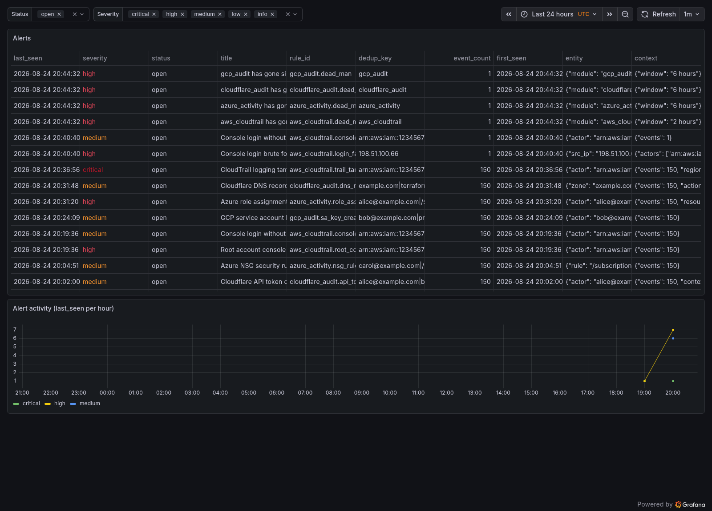
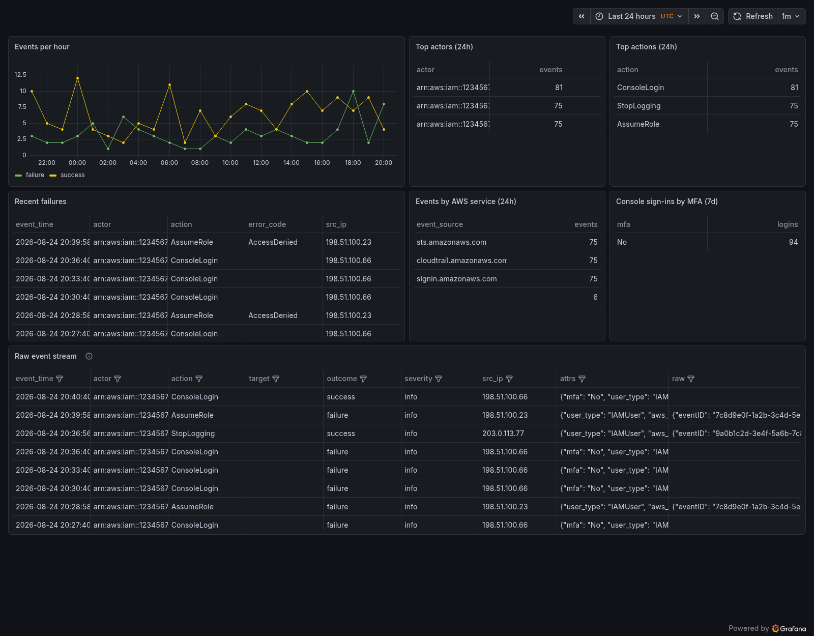

# caib — Cloud Audit In a Box

A self-hostable cloud/SaaS audit-log SIEM on boring infrastructure:
**Vector + PostgreSQL/TimescaleDB + Grafana**, packaged with Docker Compose.
Each log source is a module that ships everything end-to-end: collector config,
field mapping, migrations, a provisioned dashboard, seed detection rules, a
dead-man rule, and test fixtures.

Full design: [`caib-build-spec.md`](caib-build-spec.md). Deviations and
empirical findings: [`DECISIONS.md`](DECISIONS.md).

## Quickstart (dev)

Requires Docker with the Compose plugin.

```sh
make up        # creates .env from .env.example on first run, builds, starts
make demo      # seed fixture data (30 days) + fire sample detections — no cloud creds
# Grafana: http://localhost:3000 (admin / value of CAIB_GRAFANA_ADMIN_PASSWORD)
make logs      # follow everything
make down      # stop
```

`make demo` gets a cold clone to populated dashboards (Overview, per-module,
Alerts) and real firing alerts in under two minutes.

## What it looks like

Everything below is `make demo` output — synthetic fixture data, zero cloud
credentials, zero clicks.

**Overview** — cross-module event rates, failure rates, open alerts, ingest
health, and the raw event stream:


**Alerts** — the detection engine's output, filterable by status/severity;
recurrences fold into one row with an event count:



**Per-module dashboards** (one per source; aws_cloudtrail shown) — module
event rates, top actors/actions, failures, module-specific panels, raw stream:



Screenshots regenerate via the optional renderer overlay — see
[`compose.render.yml`](compose.render.yml).

Development also wants [`uv`](https://docs.astral.sh/uv/):

```sh
make test      # ruff + pytest (pytest starts a throwaway timescaledb container)
```

## Stack

| Component | Image | Notes |
|---|---|---|
| Database | `timescale/timescaledb:2.29.2-pg18` | TSL build required (Apache-only build lacks compression/retention/caggs) |
| Collector | `timberio/vector:0.57.0-debian` | push sources (S3/SQS, Pub/Sub) |
| Dashboards | `grafana/grafana:12.4.9` | fully provisioned, read-only DB role |
| Core services | `caib-core` (built here) | `migrate` / `loader` / `detect` entrypoints |
| Pollers | `caib-poller` (built here) | one image, `CAIB_MODULE` selects the module |

## Modules

Enable a module by starting compose with its profile, e.g.
`docker compose --profile cloudflare_audit up -d`.

| Module | Type | Status |
|---|---|---|
| `aws_cloudtrail` | push (S3 → SQS → Vector) | ready: ingest + 7 rules + dashboard |
| `gcp_audit` | push (Pub/Sub → Vector) | ready: ingest + 5 rules + dashboard; live Pub/Sub verification pending |
| `azure_activity` | poller (ARM REST) | ready: ingest + 5 rules + dashboard; live verification pending |
| `cloudflare_audit` | poller | ready: ingest + 5 rules + dashboard; live API verification pending a token |
| `slack_audit` | poller | recipe in [docs/NEW_MODULE_HOWTO.md](docs/NEW_MODULE_HOWTO.md) |
| `zoom` | poller | recipe in [docs/NEW_MODULE_HOWTO.md](docs/NEW_MODULE_HOWTO.md) |
| `knowbe4` | poller | recipe in [docs/NEW_MODULE_HOWTO.md](docs/NEW_MODULE_HOWTO.md) |

Adding a source? Read [docs/NEW_MODULE_HOWTO.md](docs/NEW_MODULE_HOWTO.md).

## Retention defaults

Events: compressed after 7 days, dropped after 90 days. Continuous aggregates
and alerts are kept much longer (cheap). Change post-install with
`remove_retention_policy` / `add_retention_policy` — do not edit migrations.

## Licensing

TimescaleDB Community Edition ships under the TSL: free to self-host and run in
production; the restriction is reselling it as a managed database service.
CAIB deployments are self-hosted, which is squarely permitted. CI asserts the
running build is the TSL one.
