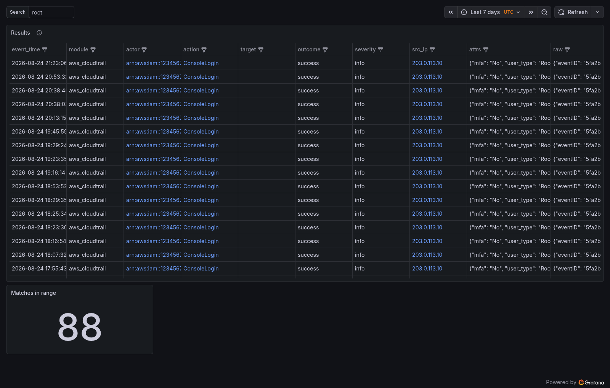

# caib — Cloud Audit In a Box

A self-hostable cloud/SaaS audit-log SIEM on boring infrastructure:
**Vector + PostgreSQL/TimescaleDB + Grafana**, packaged with Docker Compose.
Each log source is a module that ships everything end-to-end: collector config,
field mapping, migrations, a provisioned dashboard, seed detection rules, a
dead-man rule, and test fixtures.

Full design: [`caib-build-spec.md`](caib-build-spec.md). Deviations and
empirical findings: [`DECISIONS.md`](DECISIONS.md).

## Quickstart (dev)

Requires Docker with the Compose plugin.

```sh
make up        # creates .env from .env.example on first run, builds, starts
make demo      # seed fixture data (30 days) + fire sample detections — no cloud creds
# Grafana: http://localhost:3000 (admin / value of CAIB_GRAFANA_ADMIN_PASSWORD)
make logs      # follow everything
make down      # stop
```

`make demo` gets a cold clone to populated dashboards (Overview, per-module,
Alerts) and real firing alerts in under two minutes.

## What it looks like

Everything below is `make demo` output — synthetic fixture data, zero cloud
credentials, zero clicks.

**Overview** — cross-module event rates, failure rates, open alerts, ingest
health, and the raw event stream:


**Alerts** — the detection engine's output, filterable by status/severity;
recurrences fold into one row with an event count:


**Per-module dashboards** (one per source; aws_cloudtrail shown) — module
event rates, top actors/actions, failures, module-specific panels, raw stream:


**Search** — the "find `foo-prod` in everything" workflow: substring match
over every event's curated fields (actor, action, target, src_ip, attrs),
trgm-indexed on the hot window:



Screenshots regenerate via the optional renderer overlay — see
[`compose.render.yml`](compose.render.yml).

Development also wants [`uv`](https://docs.astral.sh/uv/):

```sh
make test      # ruff + pytest (pytest starts a throwaway timescaledb container)
```

## Stack

| Component | Image | Notes |
|---|---|---|
| Database | `timescale/timescaledb:2.29.2-pg18` | TSL build required (Apache-only build lacks compression/retention/caggs) |
| Collector | `timberio/vector:0.57.0-debian` | push sources (S3/SQS, Pub/Sub) |
| Dashboards | `grafana/grafana:12.4.9` | fully provisioned, read-only DB role |
| Core services | `caib-core` (built here) | `migrate` / `loader` / `detect` entrypoints |
| Pollers | `caib-poller` (built here) | one image, `CAIB_MODULE` selects the module |

## Modules

Enable a module by starting compose with its profile, e.g.
`docker compose --profile cloudflare_audit up -d`.

| Module | Type | Status |
|---|---|---|
| `aws_cloudtrail` | push (S3 → SQS → Vector) | ready: ingest + 7 rules + dashboard |
| `gcp_audit` | push (Pub/Sub → Vector) | ready: ingest + 5 rules + dashboard; live Pub/Sub verification pending |
| `azure_activity` | poller (ARM REST) | ready: ingest + 5 rules + dashboard; live verification pending |
| `cloudflare_audit` | poller | ready: ingest + 5 rules + dashboard; live API verification pending a token |
| `slack_audit` | poller | recipe in [docs/NEW_MODULE_HOWTO.md](docs/NEW_MODULE_HOWTO.md) |
| `zoom` | poller | recipe in [docs/NEW_MODULE_HOWTO.md](docs/NEW_MODULE_HOWTO.md) |
| `knowbe4` | poller | recipe in [docs/NEW_MODULE_HOWTO.md](docs/NEW_MODULE_HOWTO.md) |

Adding a source? Read [docs/NEW_MODULE_HOWTO.md](docs/NEW_MODULE_HOWTO.md).
Converting public Sigma cloud rules: `uv run python -m caib_core.sigma
--module aws_cloudtrail rule.yml` (existence shape; see the module for limits).
Slack notifications: point `CAIB_NOTIFY_WEBHOOK_URL` at an incoming webhook —
Block Kit formatting is automatic for `hooks.slack.com` URLs.
Backups: [docs/BACKUPS.md](docs/BACKUPS.md).

## High availability

```sh
make ha-up             # Patroni x3 + etcd + HAProxy (lab, single host)
make ha-failover-test  # kills the primary under write load; asserts zero loss
make ha-down
```

The HA overlay (`compose.ha.yml`) runs three `timescale/timescaledb-ha` nodes
(TSL TimescaleDB + Patroni) with etcd as DCS and HAProxy in front: writers use
`:5000` (primary only), Grafana uses `:5001` (replicas *and* primary, so
dashboards survive replica loss). Timescale's compression/retention/cagg jobs
follow the primary automatically — they're catalog state, not node state.

**Promoting the lab overlay to real hosts:**

- Run **3 etcd nodes** (the overlay runs 1 — fine for a lab, a single point of
  failure anywhere real). Point `ha/patroni.yml`'s `etcd3.host` at the cluster.
- One database node per host; replace the compose DNS names in
  `PATRONI_*_CONNECT_ADDRESS` and `ha/haproxy.cfg` with real host addresses
  (and drop the `resolvers docker` section — it exists for container DNS).
- Run HAProxy on 2+ hosts with a VIP (keepalived) or use client-side
  multi-host connection strings.
- Give each node local NVMe for `PGDATA`; set `shared_buffers` etc. for the
  hardware (the overlay ships Postgres defaults).
- Add backups before you need them: see [docs/BACKUPS.md](docs/BACKUPS.md).

## Measured performance (`make bench`)

Not asserted — measured. `make bench` replays 1M representative events
(CloudTrail/GCP/Slack-shaped, spread over 30 days) through the real
landing → loader path on a throwaway TimescaleDB and commits the results to
[`bench/results/`](bench/results/). From the committed run on an M-series
laptop (`0.1.0-2026-08-24`):

| Measurement | Result |
|---|---|
| Raw vendor JSON | 1.03 GB (1M events) |
| Loader throughput (landing → events, dedup + search_text) | **31,200 events/s** |
| Hot size (heap + indexes, rowstore) | 1.52 GB |
| After columnar compression | **0.22 GB (7.05x)** |
| Dedup re-insert against **compressed** chunks | 14,900 events/s, zero new rows |
| `module+time` filter (3d) hot → compressed | 21 ms → 2 ms |
| `search_text ILIKE` over 30 days (unindexed scan) | 0.41 s → 0.30 s |

Re-run it yourself: `make bench` (takes ~2 minutes, needs Docker).

## Retention defaults

Events: compressed after 7 days, dropped after 90 days. Continuous aggregates
and alerts are kept much longer (cheap). Change post-install with
`remove_retention_policy` / `add_retention_policy` — do not edit migrations.

## Licensing

TimescaleDB Community Edition ships under the TSL: free to self-host and run in
production; the restriction is reselling it as a managed database service.
CAIB deployments are self-hosted, which is squarely permitted. CI asserts the
running build is the TSL one.
